# Presentazioni

**Dai dati a una presentazione professionale, senza che nessun numero venga scritto a mano.**

Un agente AI (o tu) descrive la presentazione in una **Specifica** JSON, componendo solo **Layout** e **Componenti** di un **Catalogo** già pronto. I numeri arrivano da un'**Analisi** calcolata sui tuoi dati; un validatore controlla tutto prima di generare un file HTML (o PDF) pronto da inviare.

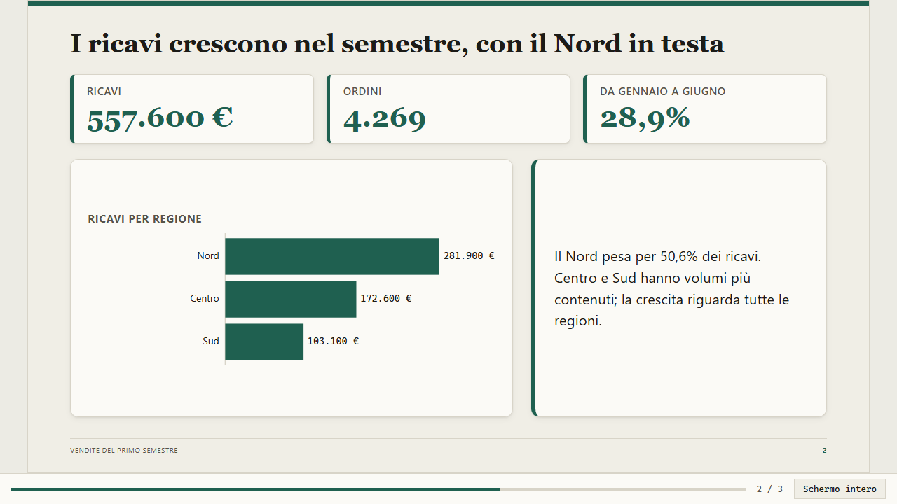

## Perché

| Problema abituale | Come lo risolve |
|---|---|
| Numeri copiati a mano che non tornano con i dati | Il testo contiene solo riferimenti `{{id}}` all'Analisi; il validatore **rifiuta ogni cifra scritta a mano** |
| Slide diverse tra loro, testo che esce dai riquadri | Layout e Componenti hanno **limiti dichiarati** (parole, punti, voci) imposti dal validatore |
| Cambiare grafica = rifare tutto | Il **Tema** si cambia con una riga, senza toccare i contenuti |
| Presentazioni difficili da versionare e rivedere | La Specifica è testo JSON: si confronta, si rivede, si rigenera |
| Stati "a colori" illeggibili in stampa o per chi non distingue i colori | Stati ed Esiti sono sempre **icona + testo**; i Temi sono verificati sul contrasto **WCAG AA** |
| Dipendenze da CDN, font esterni, installazioni | **Nessuna dipendenza npm**, nessuna risorsa esterna: funziona offline |

## Come funziona

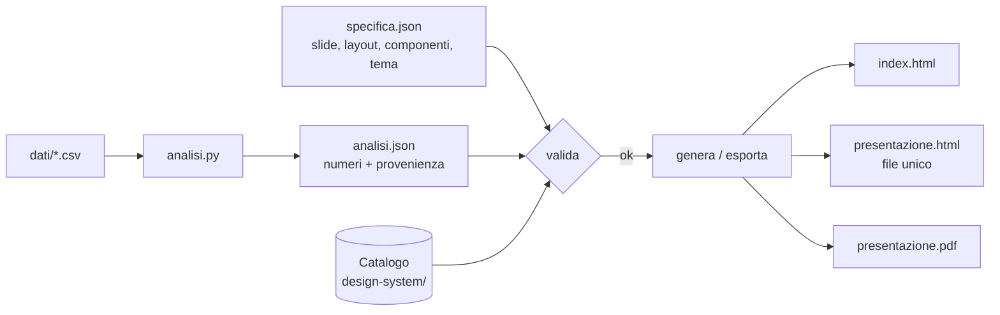

1. **Analisi**: uno script Python (`analisi.py`, pandas) legge i dati e scrive `analisi.json`. Ogni valore dichiara la sua *provenienza* (file, colonna, operazione): è la prova dei calcoli.
2. **Specifica**: `specifica.json` elenca le slide, il Layout di ciascuna e i Componenti nelle sue zone. Il testo cita i numeri con `{{id}}`.
3. **Validazione**: la Specifica è controllata contro il Catalogo e l'Analisi (layout esistenti, limiti, riferimenti, numeri a mano, contrasto dei Temi).
4. **Generazione**: HTML navigabile, file singolo autosufficiente o PDF.

La Specifica è la fonte di verità: la presentazione generata **non si modifica a mano** ([ADR 0001](docs/adr/0001-specifica-come-fonte-di-verita.md)).

## Requisiti

- **Node.js ≥ 20** (nessun `npm install`)
- **Python 3 con pandas**, solo per gli script `analisi.py`
- **Microsoft Edge**, solo per l'esportazione PDF (percorso personalizzabile con la variabile `EDGE_PATH`)

## Avvio rapido

Prova subito l'esempio incluso:

```bash
node tools/cli.mjs valida  esempi/vendite   # controlla Specifica e Analisi
node tools/cli.mjs genera  esempi/vendite   # crea esempi/vendite/dist/index.html
```

Apri `esempi/vendite/dist/index.html` nel browser.

### Crea la tua presentazione

```bash
node tools/cli.mjs nuova trimestrale        # crea presentazioni/trimestrale/
```

Lo scaffold contiene una cartella `dati/`, un `analisi.py` da completare, un `analisi.json` vuoto e una `specifica.json` con la sola copertina (già valida).

1. Copia i dati grezzi in `presentazioni/trimestrale/dati/`.
2. Completa `analisi.py` e lancia `python analisi.py` dalla cartella della presentazione.
3. Estendi `specifica.json` con le slide.
4. `node tools/cli.mjs valida presentazioni/trimestrale`
5. `node tools/cli.mjs genera presentazioni/trimestrale` e apri `dist/index.html`.

> `presentazioni/` è ignorata da git: è pensata per dati riservati. Gli esempi versionati stanno in `esempi/`.

### Comandi

| Comando | Effetto |
|---|---|
| `nuova <nome>` | Crea la struttura di una presentazione (`presentazioni/<nome>`) |
| `valida <cartella>` | Controlla Specifica e Analisi contro il Catalogo |
| `genera <cartella>` | Valida e genera `dist/index.html` con gli asset |
| `esporta-singolo <cartella>` | Valida e produce `dist/presentazione.html`, un unico file da inviare |
| `esporta-pdf <cartella>` | Produce `dist/presentazione.pdf` con Edge headless |

Ogni comando accetta `--catalogo <cartella>` (ripetibile) per aggiungere radici di Catalogo locali. Durante la presentazione: `←` `→` (o `Spazio`) per scorrere, `Home`/`End` per inizio e fine, `F` per lo schermo intero. Sotto i 900 px di larghezza la presentazione diventa una lettura verticale.

## Con un agente AI

Il progetto include la skill [`creare-presentazione`](.agents/skills/creare-presentazione/SKILL.md): basta chiedere all'agente *"fai una presentazione da questo CSV"* e seguirà il flusso scaffold → Analisi → Specifica → validazione → verifica visiva → esportazione, usando solo il Catalogo. Se gli serve un elemento che non esiste, **propone un'aggiunta al Catalogo** invece di improvvisare nella singola presentazione.

---

## Esempio completo: vendite del semestre

Tre slide, partendo da un CSV (`esempi/vendite/dati/vendite.csv`).

**1. L'Analisi** ([`analisi.py`](esempi/vendite/analisi.py)) calcola i numeri e li registra con la provenienza:

```json
"quota_nord": {
  "etichetta": "Quota dei ricavi del Nord",
  "formato": { "tipo": "percentuale", "decimali": 1 },
  "valore": 50.6,
  "provenienza": { "file": "dati/vendite.csv", "colonna": "ricavi", "operazione": "somma Nord / somma totale" }
}
```

**2. La Specifica** ([`specifica.json`](esempi/vendite/specifica.json)) compone la slide. Il titolo afferma il risultato, il commento lo spiega; i numeri sono riferimenti:

```json
{
  "layout": "risultato-grafico-commento",
  "zone": {
    "titolo": "I ricavi crescono nel semestre, con il Nord in testa",
    "kpi": [{ "componente": "kpi", "voci": [
      { "etichetta": "Ricavi", "valore": "ricavi_totale" },
      { "etichetta": "Ordini",  "valore": "ordini_totale" },
      { "etichetta": "Da gennaio a giugno", "valore": "crescita_semestre" }
    ]}],
    "grafico": [{ "componente": "grafico-barre", "serie": "ricavi_per_regione", "titolo": "Ricavi per regione" }],
    "commento": "Il Nord pesa per {{quota_nord}} dei ricavi. Centro e Sud hanno volumi più contenuti; la crescita riguarda tutte le regioni."
  }
}
```

**3. Il risultato**: `{{quota_nord}}` diventa `50,6%`, con separatori e unità della lingua scelta.

| Copertina | Slide d'analisi | Chiusura |
|:-:|:-:|:-:|
|  |  | 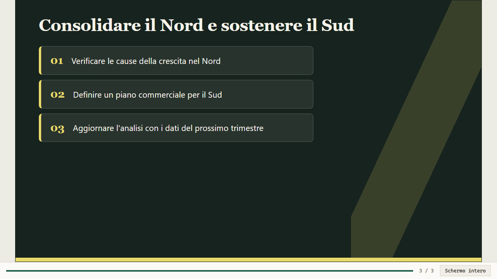 |

### Il validatore ti protegge

Se qualcuno scrive il numero a mano (`"Il Nord pesa per 51% dei ricavi"`):

```text
ERRORE slide 2 › zona "commento": numero scritto a mano "51": usare un riferimento {{id}} all'Analisi oppure aggiungerlo a "numeriAmmessi"
```

Un numero legittimo che non viene dall'Analisi (per esempio un anno) si dichiara esplicitamente in `numeriAmmessi`.

---

## I Temi

Il Tema è l'identità visiva (colori, tipografia, forme) e si cambia con una sola riga della Specifica, senza toccare i contenuti:

```json
{ "titolo": "…", "lingua": "it", "tema": "cobalto", "slide": [ … ] }
```

Qui la **stessa slide** con tutti i Temi disponibili:

| | |
|:-:|:-:|
| **`quiet-editorial`**: carta e grazie, sobrio ed editoriale | **`cobalto`**: bianco e blu, senza grazie, copertina blu notte |
| 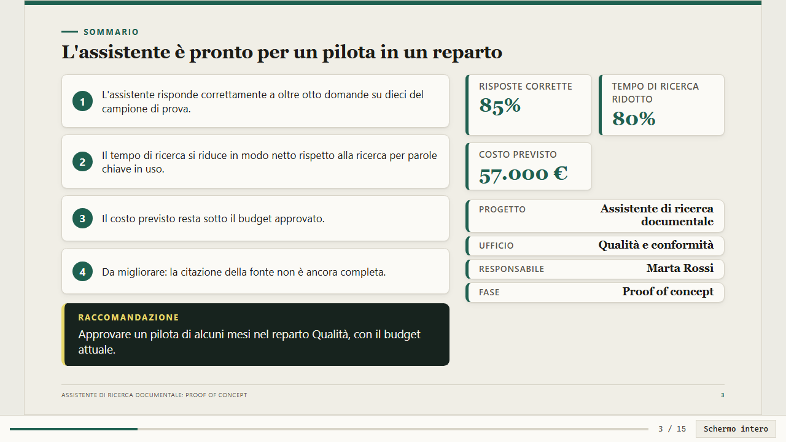 | 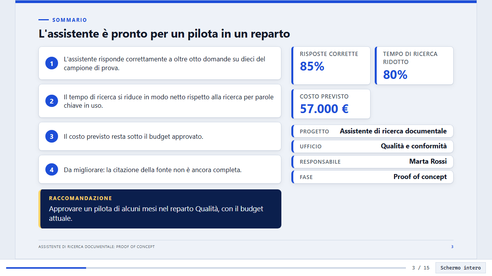 |
| **`executive`**: fondo grigio-blu, schede bianche, accento petrolio | **`istituzionale`**: serif, blu scuro e oro, spigoli netti |
| 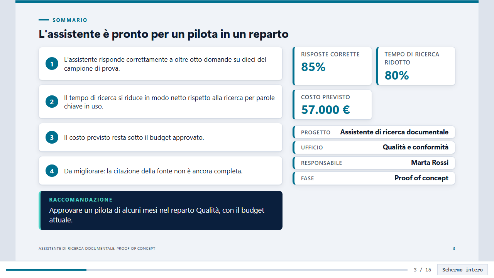 | 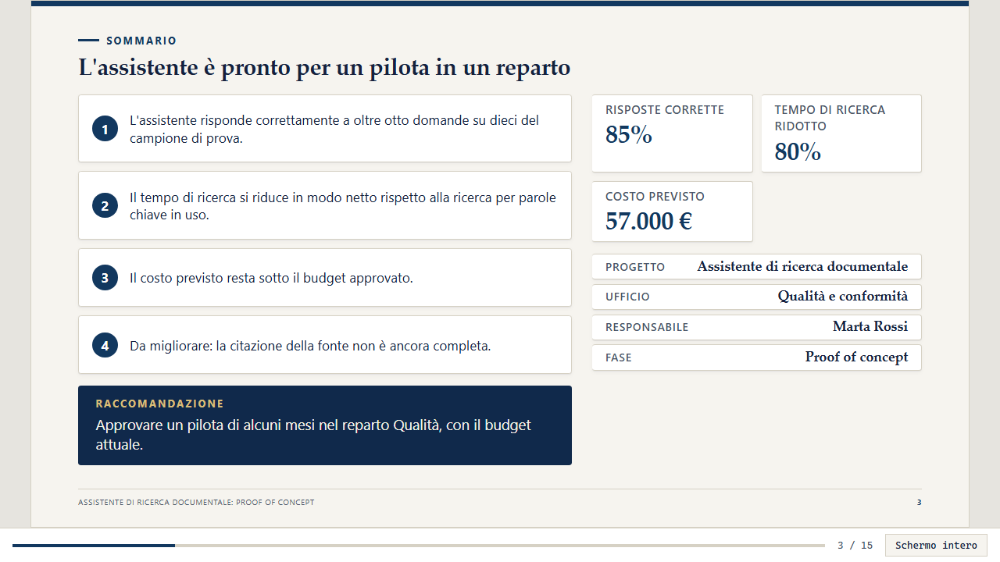 |
| **`laboratorio`**: indaco, trama a griglia, numeri in monospazio | **`programma`**: verde petrolio, angoli molto arrotondati |
| 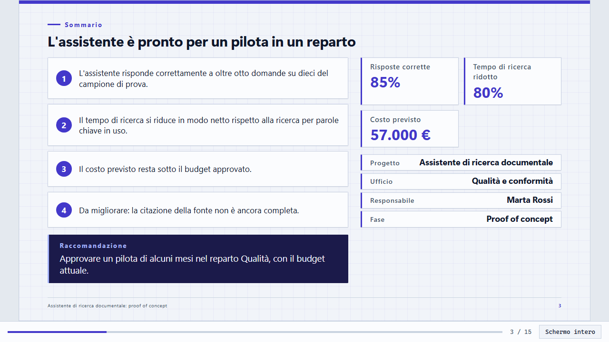 | 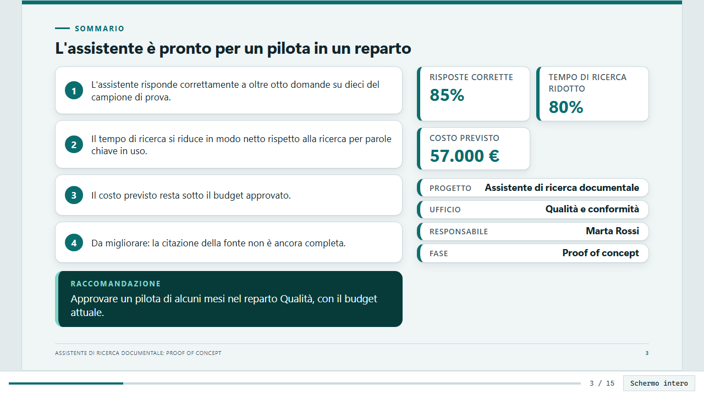 |
| **`officina`**: scuro, accento ciano, trama a griglia (in PDF resta scuro) | |
| 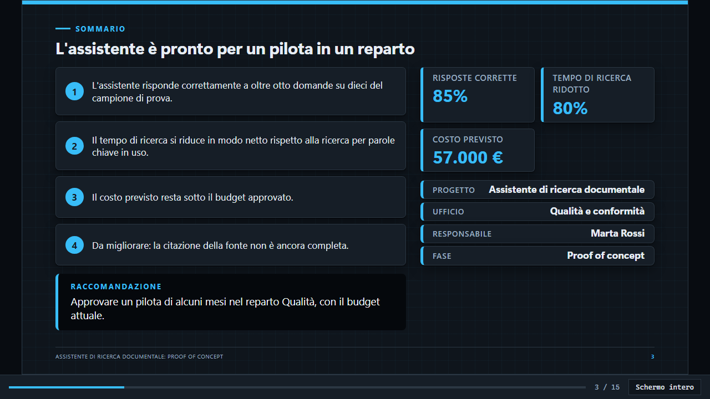 | |

Come scegliere:

| Contesto | Tema consigliato |
|---|---|
| Report di analisi, documenti da leggere | `quiet-editorial` |
| Presentazioni moderne e neutre, uso generale | `cobalto` |
| Comitati di direzione, board | `executive` |
| Enti pubblici, relazioni formali | `istituzionale` |
| PoC, sperimentazioni, contenuti tecnici | `laboratorio`, `officina` |
| Stato di programmi e iniziative | `programma` |

Ogni Tema dichiara le coppie di colori da verificare e il validatore lo **rifiuta se il contrasto è sotto WCAG AA (4,5:1)**. Creare un Tema nuovo richiede solo un `tema.json`: vedi [docs/catalogo.md](docs/catalogo.md).

## I Layout in breve

Il Catalogo offre 21 Layout. Gli esempi grafici qui sotto vengono dalla presentazione dimostrativa `esempi/catalogo-demo/` (tema `istituzionale`).

| Layout | Quando usarlo |
|---|---|
| `copertina`, `indice`, `sezione`, `chiusura` | Struttura della presentazione |
| `risultato-grafico-commento`, `dashboard-analisi` | Evidenza dei dati: KPI, grafici, commento |
| `punti-chiave`, `messaggio`, `sintesi`, `griglia-schede` | Argomenti, frasi da ricordare, conclusioni |
| `confronto`, `confronto-affiancato` | Due situazioni a confronto |
| `sommario-esecutivo`, `decisione` | Per chi decide: raccomandazione e opzioni |
| `stato-avanzamento`, `timeline-milestone`, `percorso-fasi` | Gestione di progetto |
| `rischi-matrice`, `tabella-ampia`, `esperimento`, `cartella-appendice` | Rischi, tabelle, PoC, appendice |

L'elenco completo con zone e limiti è in [docs/catalogo.md](docs/catalogo.md).

**`decisione`**: una scelta da approvare, con opzioni, vantaggi e svantaggi, raccomandazione.

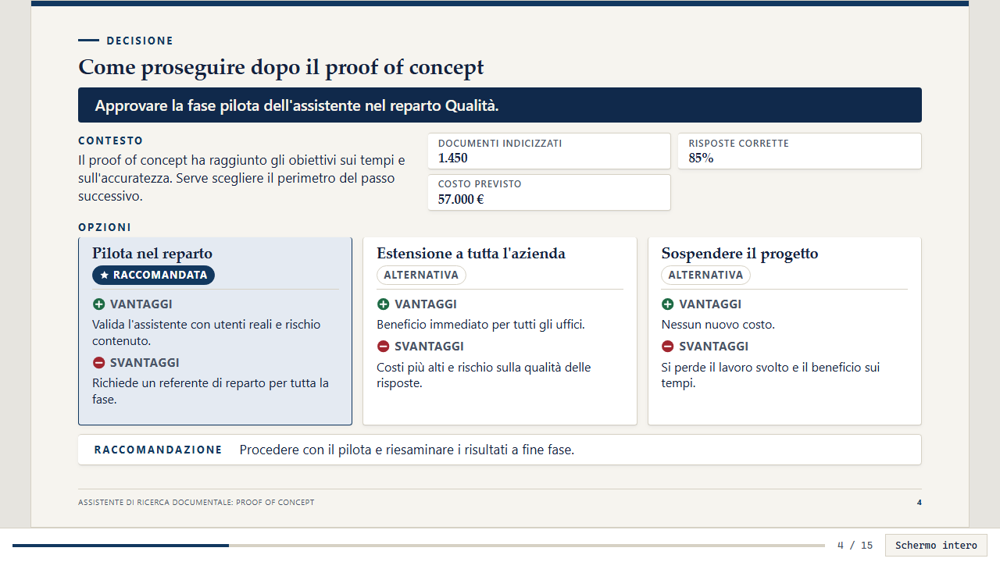

**`stato-avanzamento`**: semafori, workstream e KPI. Lo Stato è sempre icona + testo, mai solo colore.

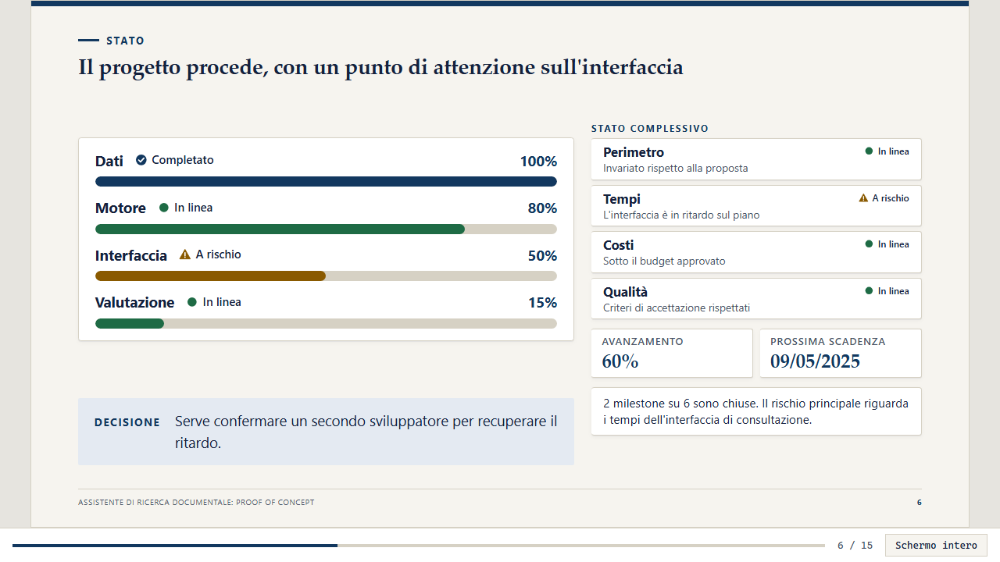

**`timeline-milestone`**: milestone su un asse in scala di data, con le azioni aperte.

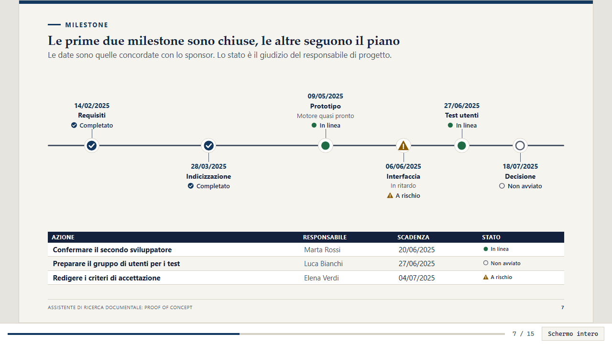

**`rischi-matrice`**: rischi per probabilità e impatto; la gravità si legge anche da motivi e numeri, non solo dal colore.

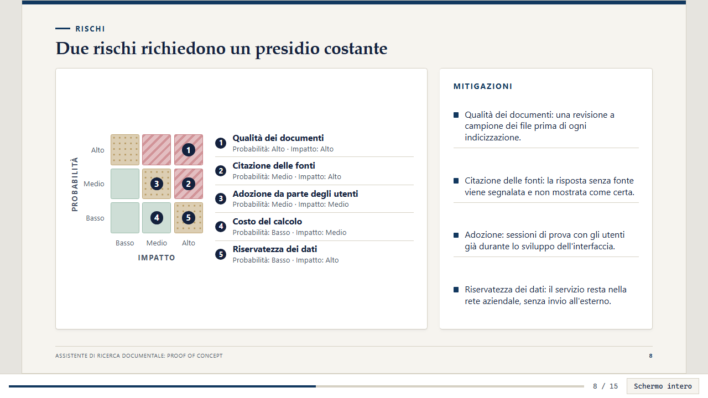

**`esperimento`**: ipotesi, metodo, risultato misurato con Esito per criterio, conclusione.

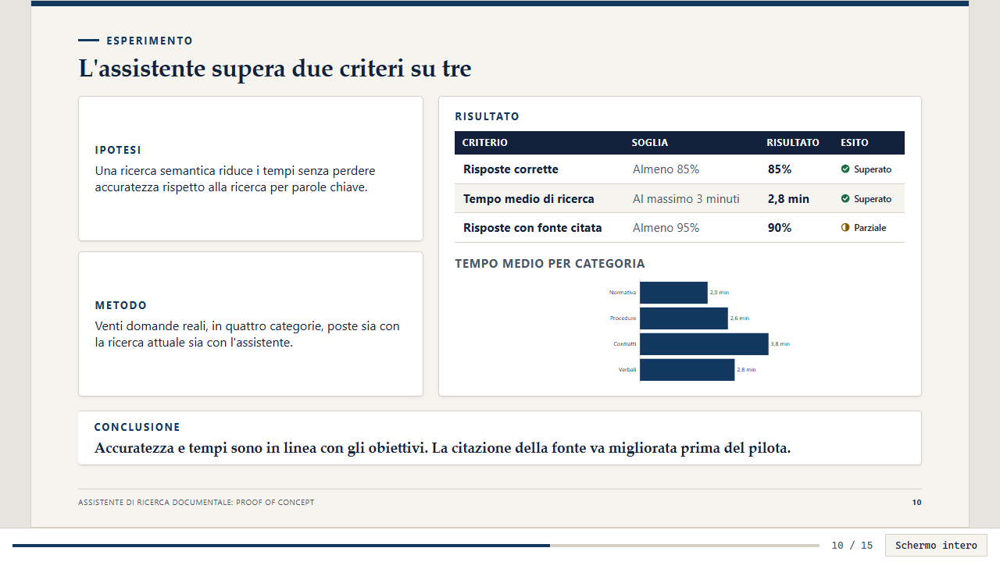

**`tabella-ampia`**: una tabella a tutta larghezza (dati, criteri, azioni).

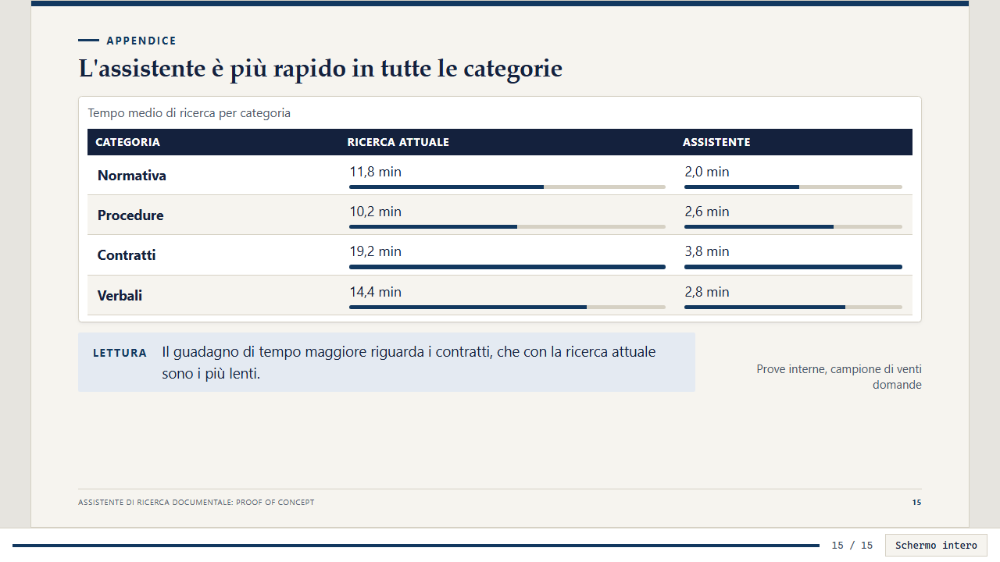

## I Componenti

I Componenti riempiono le zone dei Layout e ricevono dati dall'Analisi, non testo libero.

| Famiglia | Componenti |
|---|---|
| Numeri e grafici | `kpi`, `grafico-barre`, `grafico-linee`, `grafico-ciambella`, `grafico-cascata` |
| Tabelle e schede | `tabella-serie`, `scheda-dati`, `schede` |
| Processo e tempo | `flusso`, `timeline`, `barra-avanzamento`, `elenco-azioni` |
| Giudizi dichiarati | `semaforo` (Stato), `criteri-esito` (Esito), `matrice-rischi`, `opzioni-decisione` |
| Testo | `nota` |

**Stati ed Esiti** sono giudizi scelti da un elenco chiuso (*completato, in linea, a rischio, in ritardo, non avviato*; *superato, parziale, non superato*), non calcolati: si dichiarano nella Specifica e il validatore rifiuta valori fuori elenco ([ADR 0002](docs/adr/0002-stati-come-giudizi-dichiarati.md)).

---

## Casi d'uso

### 1. Report di analisi dati
*Dal CSV a una presentazione commentata.* Carica i dati, scrivi `analisi.py`, componi copertina → indice → slide `risultato-grafico-commento` → `punti-chiave` → `chiusura`.
**Risultato:** una presentazione coerente in cui ogni cifra è tracciabile fino al file e alla colonna di origine. → [`esempi/vendite/`](esempi/vendite)

### 2. Stato di avanzamento di un progetto
*Un aggiornamento periodico per sponsor e comitati.* Combina `sommario-esecutivo`, `stato-avanzamento`, `timeline-milestone` e `rischi-matrice`.
**Risultato:** in quattro slide lo sponsor vede stato complessivo, avanzamento per filone, prossime scadenze e rischi principali, con stati leggibili anche in bianco e nero.

### 3. Esito di un proof of concept
*Dimostrare se una sperimentazione ha raggiunto gli obiettivi.* Usa `esperimento` con `criteri-esito`: soglia, risultato misurato (dall'Analisi) ed Esito dichiarato per ogni criterio.
**Risultato:** "L'assistente supera due criteri su tre": la conclusione è sostenuta da numeri verificabili e il criterio parziale resta in evidenza.

### 4. Richiesta di decisione
*Far approvare un passo successivo.* Usa `decisione` con `opzioni-decisione`: richiesta in evidenza, contesto e dati, opzioni con vantaggi e svantaggi, raccomandazione.
**Risultato:** chi decide legge in una slide che cosa gli si chiede, perché e con quali alternative.

### 5. Condividere senza allegati
`esporta-singolo` produce un unico `.html` autosufficiente da allegare a una mail; `esporta-pdf` il PDF per stampa e archivio.

La presentazione dimostrativa [`esempi/catalogo-demo/`](esempi/catalogo-demo) (15 slide: proposta, stato, rischi, esperimento, decisione, appendice) riunisce più casi d'uso e usa ogni Layout e Componente nuovo.

---

## Estendere il Catalogo

Aggiungere un Layout, Componente, Tema o lingua **non richiede modifiche al motore**: basta una cartella con manifest, markup e stile in `design-system/`. La guida è in [docs/catalogo.md](docs/catalogo.md). Aggiungi poi un test in `tests/` e lancia `npm test`.

```text
design-system/
├── layouts/      # disposizione delle slide (manifest.json, render.mjs, stile.css)
├── componenti/   # elementi riutilizzabili (kpi, grafici, semafori, …)
├── temi/         # tema.json: colori, tipografia, forme
├── lingue/       # it.json: testi dell'interfaccia e formati numerici/date
└── assets/       # base.css, presentazione.js
esempi/           # presentazioni di esempio versionate
presentazioni/    # le tue presentazioni (ignorata da git)
tools/            # CLI e motore (validazione, generazione, esportazione)
docs/             # catalogo, ADR, immagini
tests/            # suite di test (node --test)
```

## Test

```bash
npm test
```

## Documentazione

- [CONTEXT.md](CONTEXT.md): glossario del dominio (Presentazione, Slide, Layout, Componente, Catalogo, Specifica, Tema, Analisi, Stato, Esito…)
- [docs/catalogo.md](docs/catalogo.md): Catalogo e come estenderlo
- [docs/adr/](docs/adr): decisioni di progettazione

## Licenza

[Apache License 2.0](LICENSE)